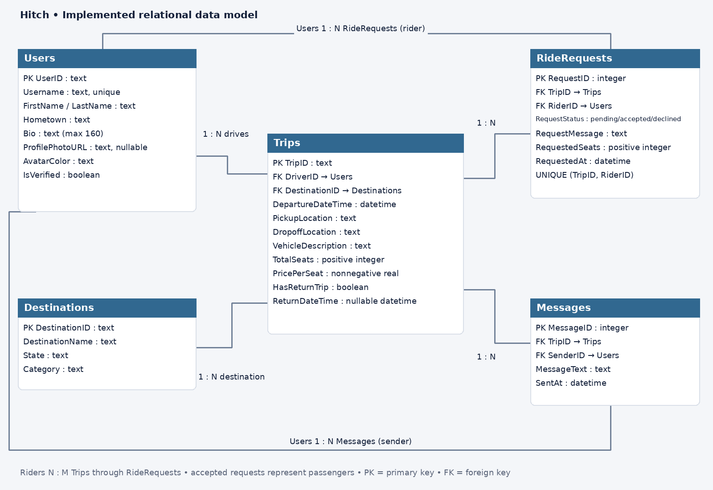

# Hitch Carpool

[Live site](https://hitched-carpool.onrender.com) · [Demo video](https://github.com/1nate-ball/hitched-carpool/raw/refs/heads/main/docs/demo.mp4) · [Submission links](SUBMISSION.md)

## App Summary

BYU students often travel to the same places on weekends and school breaks, but finding a ride usually means asking around or checking several group chats. Our app, Hitch, is meant to bring those trips into one place. Students can browse the prototype by destination and date and see who is driving, how many seats are available, and what the ride costs. The prototype also includes screens for requesting a seat, managing requests, and chatting with the people on a trip. For this assignment, we focused on getting the **Save changes** button on the profile page working with a real database. Users can edit their hometown, bio, and avatar color, and their changes are still there after refreshing the page. The current app also supports signup with a BYU email and saves posted trips to Supabase.

## ERD



Our database has five tables:

- **Users:** Student names, hometowns, bios, and profile information.
- **Destinations:** Places students can travel to.
- **Trips:** Drivers, destinations, departure and return times, seats, and prices.
- **RideRequests:** Students' requests to join a trip and whether they are pending, accepted, or declined.
- **Messages:** Messages associated with a trip and the student who sent them.

The diagram labels the one-to-many relationships. Users and trips also have a many-to-many rider relationship through RideRequests. An accepted request represents a confirmed passenger.

The table definitions are in [schema.sql](database/schema.sql), and the sample records are in [seed.json](database/seed.json). Starting the app creates the database and adds sample data to every table. It only adds that data the first time, so restarting the app does not overwrite saved profile changes.

## Key Results

**Objective 2, Key Result: posted trips average 70% of seats filled.**

For each trip, the fill rate is the number of seats on accepted ride requests (`RideRequests.RequestedSeats`) divided by `Trips.TotalSeats`, capped at 100%. The Key Result is the average of those per-trip rates. Only trips whose `DepartureDateTime` has passed are counted, so new trips that haven't had time to collect requests don't pull the average down.

Two views in [schema.sql](database/schema.sql) compute it:

- `kr_seat_fill_rate` has one row per trip: `trip_id`, `seats_total`, `accepted_seats`, `fill_rate`, and `has_departed`.
- `kr_seat_fill_rate_summary` has one row: `departed_trips` and `avg_fill_rate`.

To check the current number, run this while the server has created the database:

```sh
sqlite3 data/hitch.sqlite3 "SELECT * FROM kr_seat_fill_rate_summary;"
```

To check the math against known test data, use a separate database so the sample data isn't affected:

```sh
sqlite3 data/kr-test.sqlite3 < database/schema.sql
sqlite3 data/kr-test.sqlite3 < database/kr_seat_fill_test_seed.sql
sqlite3 data/kr-test.sqlite3 "SELECT * FROM kr_seat_fill_rate; SELECT * FROM kr_seat_fill_rate_summary;"
```

Expected results: one trip at 0.75 (3 of 4 seats), one at 0.3333 (1 of 3 seats, plus a declined request), and an average of 0.5417. The future test trip isn't counted.

**For real trips (Supabase):** the event that fills seats is a driver accepting a seat request on **Manage requests**. [The accept/decline migration](supabase/migrations/20261109000100_accept_decline_requests.sql) adds `kr_seat_fill_rate` and `kr_seat_fill_rate_summary` to Supabase with the same definition (one seat per request). They're private views; read them in the SQL Editor:

```sql
select * from public.kr_seat_fill_rate_summary;
```

`avg_fill_rate` is empty until at least one posted trip has departed.

### Accepting and declining seat requests

A driver opens **Manage requests** on their trip (from Trip details or My Trips) and sees each pending request with the rider's name and note. **Accept** or **Decline** saves `ride_requests.status` to Supabase. Accepting lowers the trip's seats left, and when no seats remain the trip drops out of Find Rides search (the `available_trips` view only lists trips with open seats). The rider sees **Seat confirmed** or **Request declined** on My Trips after their next refresh.

The database enforces the rules, not just the buttons:

- Only the trip's driver can change a request, and only its status (not the rider or note).
- Only pending requests can be decided, once: a declined rider can't be accepted later, or the other way around.
- A trip can't accept more riders than it has seats. The trip row is locked while checking, so two accepts for the last seat at the same moment can't both succeed.

Locally, `python3 scripts/check_accept_decline_schema.py` runs 18 checks against a throwaway PostgreSQL, including two accepts racing for the last seat, and `node --test tests/test_accept_decline.cjs` checks the Manage requests screen. To check it live, run [the accept/decline check](database/checks/accept_decline_live.sql) in the SQL Editor; it rolls back everything it creates and should end with a `PASS` row.

**Objective 2, Key Result: 50% of drivers post a second trip within 30 days of their first.**

This one uses the Supabase `trips` table, where the Post a Trip form saves trips. Each driver's first and second trips are found by `trips.created_at`. A driver counts as a repeat driver if their second trip was posted no more than 30 days after their first. Only drivers whose first trip was at least 30 days ago are counted, so new drivers who haven't had a full 30 days yet don't pull the rate down.

Two views in [the repeat-rate migration](supabase/migrations/20261101000100_kr_driver_repeat_rate.sql) compute it:

- `kr_driver_repeat_rate` has one row per eligible driver: `driver_id`, `first_trip_at`, `second_trip_at`, and `is_repeat`.
- `kr_driver_repeat_rate_summary` has one row: `eligible_drivers`, `repeat_drivers`, and `repeat_rate` (a percent).

Both views are private. They can be read from the Supabase SQL Editor but not through the app's public API, so driver activity isn't exposed to the browser. To check the current number, run this in the SQL Editor:

```sql
select * from public.kr_driver_repeat_rate_summary;
```

`repeat_rate` is empty until at least one driver's first trip is 30 days old.

To check the math, paste [the repeat-rate check](database/checks/kr_driver_repeat_rate_seed.sql) into the SQL Editor and run it. It adds four test drivers inside a transaction, checks for 3 eligible drivers, 1 repeat driver, and 33.3%, and then rolls everything back. It should end with a `PASS` row.

**Objective 1, Key Result 2: 100% of posted trips are linked to a signed-in driver account (no anonymous trips).**

A trip is linked when `trips.driver_id` is set and points to a Supabase Auth account. The database guarantees this for every row:

- `driver_id` is `NOT NULL` and is a foreign key to `auth.users`, so a trip can't be saved without a real account, even from the SQL Editor.
- Signed-out visitors have no access to `trips`. Signed-in users can post only as themselves (`driver_id = auth.uid()`), which the app fills in from the session.
- `driver_id` can't be changed after posting, and an account that has trips can't be deleted, so a trip never loses its driver.

These rules come from the [Post a Trip](supabase/migrations/20261027000100_post_a_trip.sql) and [Sprint 2](supabase/migrations/20261106000100_trip_locations_search_ownership.sql) migrations. [The KR2 migration](supabase/migrations/20261108000200_kr_trips_linked_to_driver.sql) adds two private views to track it:

- `kr_trip_driver_link` has one row per trip: `trip_id`, `driver_id`, `created_at`, and `is_linked`.
- `kr_trip_driver_link_summary` has one row: `trips`, `linked_trips`, and `linked_rate` (a percent).

To check the current number, run this in the Supabase SQL Editor:

```sql
select * from public.kr_trip_driver_link_summary;
```

To check the rules live, paste [the trip-driver check](database/checks/trip_driver_link_live.sql) into the SQL Editor. It tries to post anonymous, ownerless, and reassigned trips inside a transaction, expects each to be refused, and rolls everything back. It should end with a `PASS` row. Locally, `python3 scripts/check_trip_driver_link_schema.py` runs 17 checks against a throwaway PostgreSQL.

## Accounts: Sign Up, Log In, Log Out

The app opens to a **Log in** screen. New users choose **Create an account** and enter their full name, BYU email (must end in `@byu.edu`), and a password (at least 8 characters with a letter and a number). Supabase Auth creates the user, and a database trigger creates the matching row in `public.profiles` with their name. The SQL is in [the profiles migration](supabase/migrations/20261105000100_profiles_auth.sql).

- **Duplicate email:** the form says an account already exists and links to Log in.
- **Weak password:** the form checks it before sending, and also shows Supabase's own password message if Supabase rejects it.
- **Email confirmation:** if the Supabase project requires it, sign-up tells the user to check their email. The link brings them back already logged in. If confirmation is off, they are logged in right away.
- **Staying signed in:** the session is saved in the browser and refreshed automatically, so a page refresh keeps you logged in (and on the same tab).
- **Log out** (on Profile and Post a trip) clears the session and returns to the Log in screen.
- **Protected pages:** My Trips, Manage requests, Post a trip, Profile, Edit profile, and Group chat send signed-out users to Log in, then back to the page they wanted. Explore, search results, and trip details stay public; requesting a seat asks you to log in.

The profile page shows the logged-in user's name from `profiles`. Hometown, bio, and avatar color still use the shared SQLite demo profile until the profile page moves to Supabase.

To verify: create an account, refresh (still logged in), log out (back to Log in), then try opening My Trips while logged out (sent to Log in). In Supabase, check **Authentication → Users** and the `profiles` table for the new row. Run `node --test tests/test_auth.cjs` for the automated checks; they use a fake Supabase API and create no real accounts.

## Tech Stack

| Layer | What we used |
|---|---|
| Frontend | HTML, CSS, and JavaScript |
| Backend | Python's built-in HTTP server |
| Database | Supabase for accounts and posted trips; SQLite for the local classroom demo |
| Version control | GitHub |

We chose this stack because we could keep our existing screens and use Python to connect them to a database. SQLite stores the data in a file on the computer running the app, so there is no paid service or cloud account to set up. Everyone can run the same version and inspect the tables locally. No extra Python packages or API keys are needed, and `.env` files are included in `.gitignore`.

## How to Get It Running

1. Install **Python 3.10 or newer** and **Git**.
2. Open a terminal and clone the project:

   ```sh
   git clone https://github.com/1nate-ball/hitched-carpool.git
   cd hitched-carpool
   ```

3. Start the server:

   ```sh
   python3 server.py
   ```

   On Windows, use `py server.py` instead.

4. Open **http://127.0.0.1:8000** in your browser.
5. The app opens to the Log in screen. Create an account or log in, or choose **Browse trips without logging in**.

Keep the terminal running while using the app. Press **Ctrl+C** to stop it. The database is saved at `data/hitch.sqlite3` and will be used again the next time you start the server.

Open the app through the address above rather than opening the HTML file directly. This lets the page communicate with the backend. Each teammate's local copy has its own database.

If port 8000 is already in use, run `PORT=8001 python3 server.py` on macOS/Linux, or `$env:PORT='8001'; py server.py` in Windows PowerShell, and open http://127.0.0.1:8001.

## Verifying the Vertical Slice

1. Click **Edit profile**.
2. Change the hometown to `Boise, ID` and the bio to `Ready for our next road trip!`. You can also choose a different avatar color.
3. Click **Save changes**.
4. Check that the profile shows the new information and the message **Profile saved**.
5. Refresh the page. The same hometown, bio, and avatar color should still be there.

When you click Save changes, Hitch updates the signed-in account in Supabase. Refreshing reloads the same profile details. The original classroom recording uses a temporary SQLite demo database.

The [35-second demo video](https://github.com/1nate-ball/hitched-carpool/raw/refs/heads/main/docs/demo.mp4) shows this process in a real browser. To record it again, run `node scripts/record-demo.cjs` locally with Playwright and Chromium installed. The checks also confirm that profile changes survive a server restart.

To run the database and API tests:

```sh
python3 -m unittest discover -s tests -v
```

On Windows, use `py -m unittest discover -s tests -v`.

## Deploying

The live site runs on a free [Render](https://render.com) web service that redeploys whenever `main` changes. The same Python server that runs locally serves both the pages and the profile API, so the frontend and backend share one address and no CORS settings are needed. Trips and destinations use the existing Supabase project (see below), so no separate database host is needed.

**Limitation:** On Render's free plan the server's files reset on every redeploy or restart, so the local SQLite demo data resets. Free services also go to sleep when unused, so the first visit can take about a minute.

To set it up (one time):

1. Sign in at [render.com](https://render.com) with GitHub and choose **New → Web Service**.
2. Connect the `1nate-ball/hitched-carpool` repository and choose the `main` branch.
3. Use these settings:
   - **Name:** `hitched-carpool`. If the name is taken, update the Live site link above to the URL Render gives you.
   - **Language:** Python 3
   - **Build Command:** `python3 --version` (there is nothing to install)
   - **Start Command:** `python3 server.py`
   - **Instance Type:** Free
4. Under **Environment Variables**, add `HOST` = `0.0.0.0` and `PYTHON_VERSION` = `3.12.7`. Render sets `PORT` itself.
5. Click **Deploy Web Service**. Auto-deploy from `main` is on by default (Settings → Build & Deploy → Auto-Deploy).

The database tables don't need any extra setup. The server creates the SQLite tables from [schema.sql](database/schema.sql) and loads the sample data on startup. The Supabase tables already exist, and their SQL is in [supabase/migrations](supabase/migrations). Don't rerun it against the existing project.

## Sprint 1 database setup

We created a separate **Free** Supabase project for Hitch. The `destinations` and `trips` tables are set up with validation and row-level security. Our [field list and setup status](docs/post-a-trip-field-list.md) explains the exact columns and the remaining form work. The applied SQL is saved in [the initial migration file](supabase/migrations/20261027000100_post_a_trip.sql); do not run it again against the existing project.

The local server serves the public connection settings and a [client helper](public/hitch-supabase.js) for loading destinations/trips and publishing a trip with a signed-in session. The Post a Trip form now saves to the Supabase `trips` table: log in (or create an account), open Post a trip, fill in the form, and publish. Departure and return each use one date + time input, entered as Utah time. The form, preview, trip details, and seat request all use the same wording: **Pickup** and **Drop-off at destination** describe the outbound trip only, and the optional **Return trip** (destination → Provo) is shown separately, or marked "not included" for one-way trips. The form validates required fields, future dates, seats (1–7), price ($1–150), and return-after-departure, shows a confirmation only after the database saves, and shows a retryable error if the save fails. Saved trips load again after a refresh.

If a network response is lost, we check for the saved trip. If we cannot confirm the result, publishing stays disabled until you reconnect, refresh, and check My Trips before posting again. This avoids encouraging a duplicate post. Real BYU ID verification remains future work; sample riders are still demo data.

Run `node --test tests/test_post_trip.cjs` for the form regression checks. These use a simulated database API to check date/time conversion, validation, save confirmation, duplicate submission prevention, and account switching. They do not replace testing with two real Supabase test accounts.

Run `python3 scripts/check_supabase_connection.py` to check the project connection and confirm signed-out access stays blocked. The connection file contains only a publishable key, never a database password or secret key.


## Sprint 2: driver ownership, ride search, and map pins

We added a starting city to posted trips. From/To searches now query saved future trips by city and destination; signed-in search results show database trips. The open-seat count includes all accepted requests without exposing other riders' names or notes. Drivers can update only their own trips, and the browser cannot change a trip's driver ID.

Start typing a place or street address in either location field to see suggestions from Photon and Hitch’s saved meeting places. Select a result to fill the address and attach its pin. You can also choose a saved place in the map panel, click the map, or pan with the keyboard and use the map center. Keep a clear meeting address in the text field. Selected coordinates are saved with the trip and can be opened from Trip Detail after reloading. Typed addresses still work when a map is unavailable. The arrival point is separate from the optional return date/time.

We use [Leaflet 1.9.4](https://leafletjs.com/examples-v1/quick-start/) and [OpenStreetMap tiles](https://operations.osmfoundation.org/policies/tiles/) with visible attribution and normal browser caching. There is no map API key or new paid project. Address suggestions use the [Photon demo service](https://github.com/komoot/photon) and favor the starting city or selected destination. Check the pin against the agreed meeting spot. If the suggestion service is unavailable, type the address or choose the pin on the map.

The new schema is in `supabase/migrations/20261106000100_trip_locations_search_ownership.sql`. It and the previously merged seat-request migration were applied to the existing Hitch project through SQL Editor on November 6. Don't rerun either migration against these tables. Existing trips default to Provo because the original demo used BYU pickups; those older trips have no map coordinates.

Checks: `node --test tests/*.cjs`, `python3 -m unittest discover -s tests -v`, and `python3 scripts/check_sprint2_schema.py` (local PostgreSQL 18). `database/checks/sprint2_live.sql` checks database permissions and constraints inside a rollback transaction.

We also tested with two disposable accounts in a fresh local Supabase instance. Both accounts signed up and confirmed by email. The driver logged in, published a round trip with two pins and a one-way trip with typed addresses, and found the trips again after refreshing. The rider found the correct trip by starting city, destination, and date, and their pending seat request stayed in My Trips after refreshing. We checked the trip form and details at phone width, including opening the map picker from the keyboard.


PR #12 now includes Robbie's signup/login flow. A signed-out visitor going to Post a Trip logs in (or signs up), then returns to that form with their account name. Background requests from a previous login are discarded after logout or account switching. The combined form/API tests are in `tests/test_auth_trip_integration.cjs`; they use a fake Auth/Data API, not real test accounts. GitHub runs all JavaScript and Python checks on pull requests as well as main.
