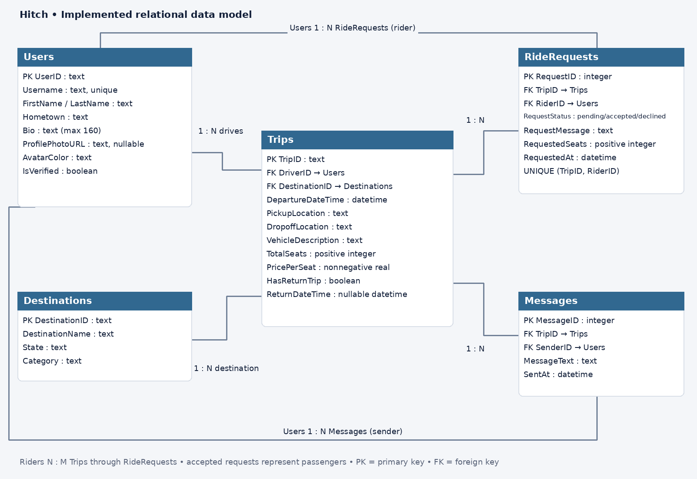

# Hitch Carpool

[Demo video](https://github.com/1nate-ball/hitched-carpool/raw/refs/heads/main/docs/demo.mp4) · [Submission links](SUBMISSION.md)

## App Summary

BYU students often travel to the same places on weekends and school breaks, but finding a ride usually means asking around or checking several group chats. Our app, Hitch, is meant to bring those trips into one place. Students can browse the prototype by destination and date and see who is driving, how many seats are available, and what the ride costs. The prototype also includes screens for requesting a seat, managing requests, and chatting with the people on a trip. For this assignment, we focused on getting the **Save changes** button on the profile page working with a real database. Users can edit their hometown, bio, and avatar color, and their changes are still there after refreshing the page. The other screens use sample data, and real BYU sign-in is not connected in this version.

## ERD



Our database has five tables:

- **Users:** Student names, hometowns, bios, and profile information.
- **Destinations:** Places students can travel to.
- **Trips:** Drivers, destinations, departure and return times, seats, and prices.
- **RideRequests:** Students' requests to join a trip and whether they are pending, accepted, or declined.
- **Messages:** Messages associated with a trip and the student who sent them.

The diagram labels the one-to-many relationships. Users and trips also have a many-to-many rider relationship through RideRequests. An accepted request represents a confirmed passenger.

The table definitions are in [schema.sql](database/schema.sql), and the sample records are in [seed.json](database/seed.json). Starting the app creates the database and adds sample data to every table. It only adds that data the first time, so restarting the app does not overwrite saved profile changes.

## Tech Stack

| Layer | What we used |
|---|---|
| Frontend | HTML, CSS, and JavaScript |
| Backend | Python's built-in HTTP server |
| Database | SQLite |
| Version control | GitHub |

We chose this stack because we could keep our existing screens and use Python to connect them to a database. SQLite stores the data in a file on the computer running the app, so there is no paid service or cloud account to set up. Everyone can run the same version and inspect the tables locally. No extra Python packages or API keys are needed, and `.env` files are included in `.gitignore`.

## How to Get It Running

1. Install **Python 3.10 or newer** and **Git**.
2. Open a terminal and clone the project:

   ```sh
   git clone https://github.com/1nate-ball/hitched-carpool.git
   cd hitched-carpool
   ```

3. Start the server:

   ```sh
   python3 server.py
   ```

   On Windows, use `py server.py` instead.

4. Open **http://127.0.0.1:8000** in your browser.
5. The app opens to Jordan Hale's sample profile. No login is needed for the demo.

Keep the terminal running while using the app. Press **Ctrl+C** to stop it. The database is saved at `data/hitch.sqlite3` and will be used again the next time you start the server.

Open the app through the address above rather than opening the HTML file directly. This lets the page communicate with the backend. Each teammate's local copy has its own database.

If port 8000 is already in use, run `PORT=8001 python3 server.py` on macOS/Linux, or `$env:PORT='8001'; py server.py` in Windows PowerShell, and open http://127.0.0.1:8001.

## Verifying the Vertical Slice

1. Click **Edit profile**.
2. Change the hometown to `Boise, ID` and the bio to `Ready for our next road trip!`. You can also choose a different avatar color.
3. Click **Save changes**.
4. Check that the profile shows the new information and the message **Profile saved to database**.
5. Refresh the page. The same hometown, bio, and avatar color should still be there.

When Save changes is clicked, JavaScript sends the edited fields to the Python backend. The backend updates the Users table in SQLite and returns the saved profile. The page displays that response, and refreshing loads the profile from the database again.

The [35-second demo video](https://github.com/1nate-ball/hitched-carpool/raw/refs/heads/main/docs/demo.mp4) shows this process. It is an automated recording of the app running in a real browser. The checks also confirm that profile changes survive a server restart.

To run the database and API tests:

```sh
python3 -m unittest discover -s tests -v
```

On Windows, use `py -m unittest discover -s tests -v`.

## Sprint 1 database setup

We created a separate **Free** Supabase project for Hitch. The `destinations` and `trips` tables are set up with validation and row-level security. Our [field list and setup status](docs/post-a-trip-field-list.md) explains the exact columns and the remaining form work. The applied SQL is saved in [the initial migration file](supabase/migrations/20261027000100_post_a_trip.sql); do not run it again against the existing project.

The local server serves the public connection settings and a [client helper](public/hitch-supabase.js) for loading destinations/trips and publishing a trip with a signed-in session. The trip form still uses prototype data until it is wired to that helper. Our working profile-save feature still uses SQLite.

Run `python3 scripts/check_supabase_connection.py` to check the project connection and confirm signed-out access stays blocked. The connection file contains only a publishable key, never a database password or secret key.
