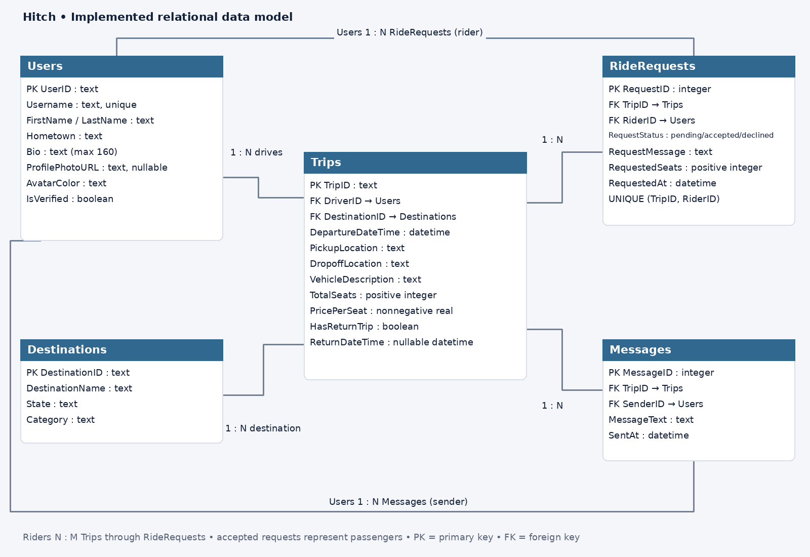
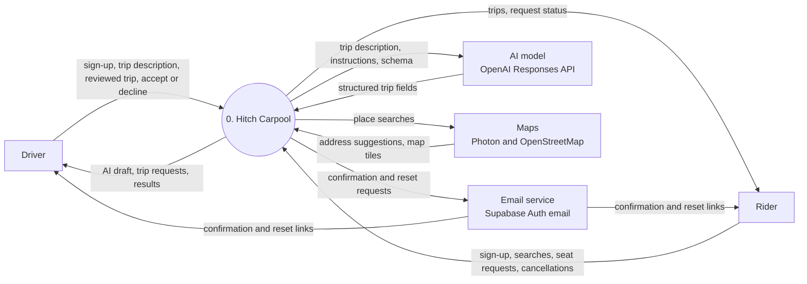

# Hitch Carpool

**Live URL: https://hitched-carpool.onrender.com**

The free server sleeps when unused, so the first visit can take about a minute. Sign up with a `@byu.edu` email to use everything.

[Demo video](https://github.com/1nate-ball/hitched-carpool/raw/refs/heads/main/docs/demo.mp4) · [Submission links](SUBMISSION.md) · [Features](#features) · [Run it locally](#how-to-get-it-running)

## Features

What a user can do on the live site, as of Sprint 3. **Complete** means it works end to end and saves to the real database. **Not complete** means it isn't built yet, or the screen exists only as a prototype that doesn't save.

**Accounts and profiles**

| Feature | Status |
|---|---|
| Sign up with a BYU email (`@byu.edu`), confirmed by an emailed link | Complete |
| Log in, log out, and stay logged in after a refresh | Complete |
| Reset a forgotten password by email | Complete |
| Show or hide passwords, and type the password twice on sign up | Complete |
| Edit profile: hometown, bio, avatar color, and profile photo | Complete |
| "Verified" badge for accounts with a confirmed BYU email | Complete |
| Student ID or driver's license verification | Not complete (planned) |

**Drivers**

| Feature | Status |
|---|---|
| Post a trip: route, dates and times, seats, price, and an optional return trip | Complete |
| Only verified drivers can post (enforced by the database) | Complete |
| Describe your trip in plain words and let AI fill in the form | Complete |
| Any destination, with address suggestions and map pins | Complete |
| Accept or decline seat requests; seats left updates | Complete |
| Car details and a 4-digit pickup code, shown only to accepted riders | Complete |
| Cancel a posted trip | Complete |
| Auto-generated pictures for new destinations | Not complete (new places show a drawn picture) |

**Riders**

| Feature | Status |
|---|---|
| Find rides by destination, starting city, and date | Complete |
| Request a seat with a note | Complete |
| Cancel a seat request or a confirmed seat (the seat goes back to the trip) | Complete |
| My Trips: rider and driver views, grouped by Today, This week, and This month | Complete |
| Full and cancelled trips leave search | Complete |
| Women-only rides | Not complete ([proposal only](docs/women-only-rides-proposal.md)) |

**Notifications, chat, and admin**

| Feature | Status |
|---|---|
| In-app notifications: new seat requests to the driver, accept/decline to the rider | Complete (see [Notifications](#notifications-seat-requests-and-decisions)) |
| Email and push notifications | Not complete (later work) |
| Trip group chat | Not complete (the screen is a prototype; messages aren't saved) |
| Admin-only Hitch stats page with all four Key Results, computed live | Complete |

## App Summary

BYU students often travel to the same places on weekends and school breaks, but finding a ride usually means asking around or checking several group chats. Our app, Hitch, is meant to bring those trips into one place. Students can browse the prototype by destination and date and see who is driving, how many seats are available, and what the ride costs. The prototype also includes screens for requesting a seat, managing requests, and chatting with the people on a trip. For this assignment, we focused on getting the **Save changes** button on the profile page working with a real database. Users can edit their hometown, bio, and avatar color, and their changes are still there after refreshing the page. The current app also supports signup with a BYU email and saves posted trips to Supabase.

## ERD



Our database has five tables:

- **Users:** Student names, hometowns, bios, and profile information.
- **Destinations:** Places students can travel to.
- **Trips:** Drivers, destinations, departure and return times, seats, and prices.
- **RideRequests:** Students' requests to join a trip and whether they are pending, accepted, or declined.
- **Messages:** Messages associated with a trip and the student who sent them.

The diagram labels the one-to-many relationships. Users and trips also have a many-to-many rider relationship through RideRequests. An accepted request represents a confirmed passenger.

The table definitions are in [schema.sql](database/schema.sql), and the sample records are in [seed.json](database/seed.json). Starting the app creates the database and adds sample data to every table. It only adds that data the first time, so restarting the app does not overwrite saved profile changes.

## Key Results

**All four Key Results are shown live on the admin-only Hitch stats page** (Profile → **Hitch stats**). The page shows:
- Each Key Result's current value against its target, with an "On target" or "Below target" tag.
- The counts behind each value, plus a "How it's calculated" note.
- A count of how many Key Results are on target.

The database computes every number from `trips`, `ride_requests`, and Supabase Auth each time the page loads. It also refreshes every minute while open. Nothing is typed in or stored.

| Key Result | Target | Calculated from |
|---|---|---|
| Objective 1, KR 1: drivers are verified | 100% | `kr_driver_verification_summary` |
| Objective 1, KR 2: trips linked to a driver account | 100% | `kr_trip_driver_link_summary` |
| Objective 2: posted trips average 70% of seats filled | 70% | `kr_seat_fill_rate` |
| Objective 2: drivers post a second trip | 50% | `kr_driver_repeat_rate_summary` |

The page calls `okr_stats()` ([migration](supabase/migrations/20261117000100_okr_stats.sql)), which returns one row per Key Result with counts and rates only (no ids, names, or emails). Only accounts in `admins` can call it (see the seat fill section below for how to add one). If a Key Result's view hasn't been created in the database yet, that card shows "Not set up yet" and the others still load.

**Checks:**
- `python3 scripts/check_okr_stats_schema.py` runs 9 checks with known data for all four Key Results.
- `node --test tests/test_stats.cjs` checks the page.
- To check it live, run [the OKR check](database/checks/okr_stats_live.sql) in the SQL Editor. It confirms all four are set up and match the views, and it names the migration to run if one isn't.

**Objective 1, Key Result 1: 100% of drivers are verified.**

**What "verified" means:** the person signed up with a BYU email address (ending in `byu.edu`) and confirmed it by clicking the link Supabase emailed to that inbox, so they have a working BYU account. It does not check a student ID, driver's license, driving record, or insurance. Student ID review is planned as a later level of verification. The app shows this same explanation under **What does Verified mean?** on Trip details and Profile.

The database enforces it. [The driver verification migration](supabase/migrations/20261108000100_driver_verification.sql) changes the `trips` insert policy so only verified users can post a trip, which means every trip posted since the migration has a verified driver. The BYU email rule is checked in the database as well as on the sign-up form, so going around the form doesn't help. Badges for drivers of saved trips and the signed-in user's own status come from the same check (`verification_status`), which returns only yes/no and never emails.

Two private views measure it, including any trips posted before the rule existed:

- `kr_driver_verification` has one row per driver who has posted a trip: `driver_id`, `is_verified`, `trips_posted`, and `first_trip_at`.
- `kr_driver_verification_summary` has one row: `drivers`, `verified_drivers`, and `verified_rate` (a percent).

To check the current number, run this in the Supabase SQL Editor:

```sql
select * from public.kr_driver_verification_summary;
```

If it's under 100%, `select * from public.kr_driver_verification where not is_verified;` lists the drivers whose trips predate the rule (for example dashboard test accounts without a BYU email).

To check the rule live, paste [the verification check](database/checks/driver_verification_live.sql) into the SQL Editor. It creates three test users inside a transaction, confirms only the one with a confirmed BYU email can post, and rolls everything back. It should end with a `PASS` row. Locally, `python3 scripts/check_driver_verification_schema.py` runs 23 checks against a throwaway PostgreSQL, and `node --test tests/test_driver_verification.cjs` checks the badges and gates in the app.

**Objective 2, Key Result: posted trips average 70% of seats filled.**

For each trip, the fill rate is the number of seats on accepted ride requests (`RideRequests.RequestedSeats`) divided by `Trips.TotalSeats`, capped at 100%. The Key Result is the average of those per-trip rates. Only trips whose `DepartureDateTime` has passed are counted, so new trips that haven't had time to collect requests don't pull the average down.

Two views in [schema.sql](database/schema.sql) compute it:

- `kr_seat_fill_rate` has one row per trip: `trip_id`, `seats_total`, `accepted_seats`, `fill_rate`, and `has_departed`.
- `kr_seat_fill_rate_summary` has one row: `departed_trips` and `avg_fill_rate`.

To check the current number, run this while the server has created the database:

```sh
sqlite3 data/hitch.sqlite3 "SELECT * FROM kr_seat_fill_rate_summary;"
```

To check the math against known test data, use a separate database so the sample data isn't affected:

```sh
sqlite3 data/kr-test.sqlite3 < database/schema.sql
sqlite3 data/kr-test.sqlite3 < database/kr_seat_fill_test_seed.sql
sqlite3 data/kr-test.sqlite3 "SELECT * FROM kr_seat_fill_rate; SELECT * FROM kr_seat_fill_rate_summary;"
```

Expected results: one trip at 0.75 (3 of 4 seats), one at 0.3333 (1 of 3 seats, plus a declined request), and an average of 0.5417. The future test trip isn't counted.

**For real trips (Supabase), shown live in the app.** Admins see the number on **Profile → Hitch stats**. The page asks the database every time it opens, refreshes itself every minute while open, and has a Refresh button. No number is typed in or stored.

What the page shows:
- **Headline (the Key Result):** the average per-trip fill rate across departed trips, compared with the 70% target.
- **Departed trips:** accepted seats out of total seats, summed across departed trips. This is the plain "accepted ÷ seats" total.
- **Upcoming trips:** seats filled so far on trips that haven't left. These don't count toward the Key Result until they depart.

**Where the numbers come from:**

| Table | Column | Role in the metric |
|---|---|---|
| `trips` | `total_seats` | Seats per trip (the denominator) |
| `trips` | `departure_at` | Only trips that have departed count toward the KR |
| `trips` | `cancelled_at` | Cancelled trips are left out |
| `ride_requests` | `status = 'accepted'` | One accepted seat per request (the numerator) |

**Events that change it:**
- A driver **posts a trip**: more seats.
- A driver **accepts** a request on Manage requests: +1 filled seat.
- A rider **cancels an accepted seat**: −1 filled seat.
- A driver **cancels a trip**: the trip leaves the metric.
- A trip's **departure time passes**: it moves from Upcoming into the KR average.

Requesting a seat or declining one doesn't change the number.

**How it's built:**
- `kr_seat_fill_rate` gives one row per trip, and `kr_seat_fill_rate_summary` gives the average. Both are private: readable in the SQL Editor, never through the API.
- `seat_fill_stats()` ([migration](supabase/migrations/20261116000100_seat_fill_stats.sql)) is what the app calls. It returns one row of totals with no trip ids, names, or riders, and refuses anyone who isn't an admin.

**Admins** are listed in the `admins` table, which can only be changed from the SQL Editor. To add someone (they need a Hitch account first):

```sql
insert into public.admins (user_id) select id from auth.users where email = 'someone@byu.edu';
```

They see the Hitch stats link the next time they log in.

**Checks:**
- `node --test tests/test_stats.cjs` checks the screen.
- `python3 scripts/check_seat_fill_stats_schema.py` runs 16 checks against a throwaway PostgreSQL, using the same test data as the SQLite seed (expects 0.5417).
- To check it live, paste [the stats check](database/checks/seat_fill_stats_live.sql) into the SQL Editor. It should end with a `PASS` row.

You can also read the numbers directly in the SQL Editor:

```sql
select * from public.kr_seat_fill_rate_summary;
```

`avg_fill_rate` is empty until at least one posted trip has departed.

### Accepting and declining seat requests

A driver opens **Manage requests** on their trip (from Trip details or My Trips) and sees each pending request with the rider's name and note. **Accept** or **Decline** saves `ride_requests.status` to Supabase. Accepting lowers the trip's seats left, and when no seats remain the trip drops out of Find Rides search (the `available_trips` view only lists trips with open seats). The rider sees **Seat confirmed** or **Request declined** on My Trips after their next refresh.

The database enforces the rules, not just the buttons:

- Only the trip's driver can change a request, and only its status (not the rider or note).
- Only pending requests can be decided, once: a declined rider can't be accepted later, or the other way around.
- A trip can't accept more riders than it has seats. The trip row is locked while checking, so two accepts for the last seat at the same moment can't both succeed.

Locally, `python3 scripts/check_accept_decline_schema.py` runs 18 checks against a throwaway PostgreSQL, including two accepts racing for the last seat, and `node --test tests/test_accept_decline.cjs` checks the Manage requests screen. To check it live, run [the accept/decline check](database/checks/accept_decline_live.sql) in the SQL Editor; it rolls back everything it creates and should end with a `PASS` row.

**Objective 2, Key Result: 50% of drivers post a second trip.**

This one uses the Supabase `trips` table, where the Post a Trip form saves trips. A driver is anyone who has posted at least one trip. A driver counts as a repeat driver as soon as they post their second trip, so the number changes on the next refresh.

We first measured "a second trip within 30 days, counting only drivers whose first trip is at least 30 days old." That couldn't show any data until a driver's first trip was a month old, which is longer than the sprint. [The redefinition](supabase/migrations/20261119000100_kr_repeat_drivers_any.sql) counts every driver and keeps the same view names and columns.

Two views, created in [the repeat-rate migration](supabase/migrations/20261101000100_kr_driver_repeat_rate.sql) and redefined in the migration above, compute it:

- `kr_driver_repeat_rate` has one row per driver: `driver_id`, `first_trip_at`, `second_trip_at`, and `is_repeat`.
- `kr_driver_repeat_rate_summary` has one row: `eligible_drivers` (every driver), `repeat_drivers`, and `repeat_rate` (a percent).

Both views are private. They can be read from the Supabase SQL Editor but not through the app's public API, so driver activity isn't exposed to the browser. To check the current number, run this in the SQL Editor:

```sql
select * from public.kr_driver_repeat_rate_summary;
```

`repeat_rate` is empty until someone posts a trip.

To check the math, paste [the repeat-rate check](database/checks/kr_driver_repeat_rate_seed.sql) into the SQL Editor and run it. It adds four test drivers inside a transaction, checks for 4 drivers, 2 repeat drivers, and 50.0%, and then rolls everything back. It should end with a `PASS` row.

**Objective 1, Key Result 2: 100% of posted trips are linked to a signed-in driver account (no anonymous trips).**

A trip is linked when `trips.driver_id` is set and points to a Supabase Auth account. The database guarantees this for every row:

- `driver_id` is `NOT NULL` and is a foreign key to `auth.users`, so a trip can't be saved without a real account, even from the SQL Editor.
- Signed-out visitors have no access to `trips`. Signed-in users can post only as themselves (`driver_id = auth.uid()`), which the app fills in from the session.
- `driver_id` can't be changed after posting, and an account that has trips can't be deleted, so a trip never loses its driver.

These rules come from the [Post a Trip](supabase/migrations/20261027000100_post_a_trip.sql) and [Sprint 2](supabase/migrations/20261106000100_trip_locations_search_ownership.sql) migrations. [The KR2 migration](supabase/migrations/20261108000200_kr_trips_linked_to_driver.sql) adds two private views to track it:

- `kr_trip_driver_link` has one row per trip: `trip_id`, `driver_id`, `created_at`, and `is_linked`.
- `kr_trip_driver_link_summary` has one row: `trips`, `linked_trips`, and `linked_rate` (a percent).

To check the current number, run this in the Supabase SQL Editor:

```sql
select * from public.kr_trip_driver_link_summary;
```

To check the rules live, paste [the trip-driver check](database/checks/trip_driver_link_live.sql) into the SQL Editor. It tries to post anonymous, ownerless, and reassigned trips inside a transaction, expects each to be refused, and rolls everything back. It should end with a `PASS` row. Locally, `python3 scripts/check_trip_driver_link_schema.py` runs 17 checks against a throwaway PostgreSQL.

## Accounts: Sign Up, Log In, Log Out

The app opens to a **Log in** screen. New users choose **Create an account** and enter their full name, BYU email (must end in `@byu.edu`), and a password (at least 8 characters with a letter and a number). Supabase Auth creates the user, and a database trigger creates the matching row in `public.profiles` with their name. The SQL is in [the profiles migration](supabase/migrations/20261105000100_profiles_auth.sql).

- **Duplicate email:** the form says an account already exists and links to Log in.
- **Weak password:** the form checks it before sending, and also shows Supabase's own password message if Supabase rejects it.
- **Email confirmation:** if the Supabase project requires it, sign-up tells the user to check their email. The link brings them back already logged in. If confirmation is off, they are logged in right away.
- **Staying signed in:** the session is saved in the browser and refreshed automatically, so a page refresh keeps you logged in (and on the same tab).
- **Log out** (on Profile and Post a trip) clears the session and returns to the Log in screen.
- **Protected pages:** My Trips, Manage requests, Post a trip, Profile, Edit profile, and Group chat send signed-out users to Log in, then back to the page they wanted. Explore, search results, and trip details stay public; requesting a seat asks you to log in.

Signup also offers an optional hometown and short bio. On signup and under **Edit profile**, search for a U.S. hometown and choose a result to save it as `City, ST`. The list comes from the [2025 U.S. Census Gazetteer](https://www.census.gov/geographies/reference-files/time-series/geo/gazetteer-files.2025.html). Profile details are saved to the signed-in account. An existing hometown stays as entered until you replace or clear it.

To verify: create an account, refresh (still logged in), log out (back to Log in), then try opening My Trips while logged out (sent to Log in). In Supabase, check **Authentication → Users** and the `profiles` table for the new row. Run `node --test tests/test_auth.cjs` for the automated checks; they use a fake Supabase API and create no real accounts.

## Tech Stack

| Layer | What we used |
|---|---|
| Frontend | HTML, CSS, and JavaScript |
| Backend | Python's built-in HTTP server |
| Database | Supabase for accounts and posted trips; SQLite for the local classroom demo |
| Version control | GitHub |

We chose this stack because we could keep our existing screens and use Python to connect them to a database. SQLite stores the local demo data in a file. Everyone can run the same version and inspect those tables locally. No extra Python packages are needed. The optional AI helper needs a server-side OpenAI key; manual trip posting works without it. `.env` files are included in `.gitignore`.

## AI workflow: describe your trip

On **Post a trip**, we added an optional **Describe your trip** box. A driver writes the route, exact dates and times, seats, and price, then clicks **Fill trip details**. Our Python backend verifies the signed-in driver and sends the description to OpenAI's Responses API. AI extracts structured fields, the backend validates them, and the app fills blank fields for the driver to review. **Publish trip** is still a separate step that saves through our existing Supabase workflow.

We use OpenAI Structured Outputs with `gpt-5.6-terra` by default and no reasoning step, tools, or conversation history. The request uses `store: false`. The model does not receive the driver's account, password, car details, or other trips. The description itself is sent to OpenAI, as explained next to the button. Missing or invalid values stay blank; drivers still need to check the result. AI does not create map pins, verify accounts, or post trips on its own.

### AI setup

In Render's **Environment** settings, add `OPENAI_API_KEY`. The existing `OpenAI_Key` setting is also accepted, so either name works. Never put the real key in `public/`, `supabase-config.json`, or GitHub. For local development, the same setting can go in an ignored `.env` beside `server.py`; the AI helper reads only the requested AI setting from that file. Process environment variables take precedence. `OPENAI_MODEL` optionally selects another compatible structured-output model.

The helper has a 2,000-character input limit, bounded response size and duration, no duplicate generation while a request is pending, and limits of 5 requests per minute and 20 per hour per account, 4 simultaneous requests, and 200 requests per day across this server. These limits are for the class demo and reset when the process restarts; the provider's own project budget is separate. If the key is missing or AI is unavailable, the app explains the problem and leaves manual posting available.

To demonstrate it, sign in with a confirmed BYU email, open **Post a trip**, and enter:

> Driving from Provo to Moab on November 20, 2026 at 4 PM. Pick up at Wilkinson Student Center and drop off at Moab Visitor Center. I have 3 seats at $25 per seat. Returning November 22, 2026 at 6 PM.

Click **Fill trip details**, review or edit the result, then **Publish trip** and show the saved trip after refreshing. Use future explicit dates when rehearsing later. A successful demo must use the real OpenAI connection; a mocked test response is not proof of the live workflow.

### Level 0 data flow diagram

The whole system as one process, with everything outside it. The Level 1 diagram below opens it up.



### Level 1 data flow diagram: the AI workflow

How a driver's typed description becomes a posted trip that riders can request. Rectangles are external entities, rounded boxes are processes, and cylinders are data stores. D1–D3 are Supabase tables; D4 is in the Python server's memory.


The diagram's source is [docs/ai-workflow-dfd-level1.mmd](docs/ai-workflow-dfd-level1.mmd). After editing it, regenerate the image with the command at the top of that file.

| # | Process | What happens | Code |
|---|---|---|---|
| 1.0 | Sign up and confirm BYU email | Supabase Auth creates the account in D1 and asks the email service to send a confirmation link. Clicking it marks the BYU email confirmed, which is what "verified" means. | `hitch-supabase.js` `signUp` |
| 2.0 | Check driver and AI limits | The Python server checks the sign-in token and BYU verification against D1, then the per-account and per-day limits in D4. | `ai_trip_draft.py` `verified_driver`, `DraftLimiter` |
| 3.0 | Extract trip fields with AI | Sends only the description, fixed instructions, and a strict JSON schema to the AI model (`store: false`). No account details, car details, or other trips. | `generate_draft` |
| 4.0 | Validate draft, fill blank fields | Drops any value that isn't literally in the description, is in the past, or is out of range. The browser then fills only blank fields the driver hasn't touched, and lists what's missing. | `validate_draft`, `hitch-ai.js` |
| 5.0 | Review and publish trip | The driver checks and edits the form, picks map pins, and clicks **Publish trip**. The database refuses trips from unverified drivers. | `publishTrip` |
| 6.0 | Find a ride and request a seat | Riders search open trips (D2) and send or cancel seat requests (D3). | `searchTrips`, `requestSeat`, `cancelRequest` |
| 7.0 | Accept or decline requests | The driver decides on pending requests in D3. Accepted requests lower the seats left. | `decideRequest` |

**What the AI cannot do:** there is no flow from 3.0 or 4.0 to any data store. The AI model never sees D1–D3, and its output only reaches the driver's form. Only the driver's own **Publish trip** (5.0) writes a trip.

**Left out to keep this readable:** profile editing and photos, password reset (another email-service flow), pickup codes, and drivers cancelling trips. They don't pass through the AI workflow. Password reset and maps are shown at Level 0.

Run `python3 -m unittest discover -s tests -v` and `node --test tests/*.cjs` for the automated checks. The AI tests use fake provider replies to cover validation, failures, authentication, duplicate requests, account changes, and preserving manual edits without spending API credits. Browser testing with the real provider is a separate release check.

## How to Get It Running

1. Install **Python 3.10 or newer** and **Git**.
2. Open a terminal and clone the project:

   ```sh
   git clone https://github.com/1nate-ball/hitched-carpool.git
   cd hitched-carpool
   ```

3. Start the server:

   ```sh
   python3 server.py
   ```

   On Windows, use `py server.py` instead.

4. Open **http://127.0.0.1:8000** in your browser.
5. The app opens to the Log in screen. Create an account or log in, or choose **Browse trips without logging in**.
6. Optional: to use **Describe your trip** (AI), copy `.env.example` to `.env` and add your `OPENAI_API_KEY` (see [AI setup](#ai-setup)). Everything else works without it.
7. Optional: run the automated checks with `python3 -m unittest discover -s tests -v` and `node --test tests/*.cjs` (Node 22).

There is nothing to install: the server uses only Python's standard library. Your local copy connects to the team's Supabase project through `public/supabase-config.json`, which holds only the publishable key, so accounts and trips are the same as on the live site.

Keep the terminal running while using the app. Press **Ctrl+C** to stop it. The database is saved at `data/hitch.sqlite3` and will be used again the next time you start the server.

Open the app through the address above rather than opening the HTML file directly. This lets the page communicate with the backend. Each teammate's local copy has its own database.

If port 8000 is already in use, run `PORT=8001 python3 server.py` on macOS/Linux, or `$env:PORT='8001'; py server.py` in Windows PowerShell, and open http://127.0.0.1:8001.

## Verifying the Vertical Slice

1. Click **Edit profile**.
2. Search for and select `Boise, ID` as the hometown, and change the bio to `Ready for our next road trip!`. You can also choose a different avatar color.
3. Click **Save changes**.
4. Check that the profile shows the new information and the message **Profile saved**.
5. Refresh the page. The same hometown, bio, and avatar color should still be there.

When you click Save changes, Hitch updates the signed-in account in Supabase. Refreshing reloads the same profile details. The original classroom recording uses a temporary SQLite demo database.

The [35-second demo video](https://github.com/1nate-ball/hitched-carpool/raw/refs/heads/main/docs/demo.mp4) shows this process in a real browser. To record it again, run `node scripts/record-demo.cjs` locally with Playwright and Chromium installed. The checks also confirm that profile changes survive a server restart.

To run the database and API tests:

```sh
python3 -m unittest discover -s tests -v
```

On Windows, use `py -m unittest discover -s tests -v`.

## Deploying

The live site runs on a free [Render](https://render.com) web service that redeploys whenever `main` changes. The same Python server that runs locally serves both the pages and the profile API, so the frontend and backend share one address and no CORS settings are needed. Trips and destinations use the existing Supabase project (see below), so no separate database host is needed.

**Limitation:** On Render's free plan the server's files reset on every redeploy or restart, so the local SQLite demo data resets. Free services also go to sleep when unused, so the first visit can take about a minute.

To set it up (one time):

1. Sign in at [render.com](https://render.com) with GitHub and choose **New → Web Service**.
2. Connect the `1nate-ball/hitched-carpool` repository and choose the `main` branch.
3. Use these settings:
   - **Name:** `hitched-carpool`. If the name is taken, update the Live site link above to the URL Render gives you.
   - **Language:** Python 3
   - **Build Command:** `python3 --version` (there is nothing to install)
   - **Start Command:** `python3 server.py`
   - **Instance Type:** Free
4. Under **Environment Variables**, add `HOST` = `0.0.0.0` and `PYTHON_VERSION` = `3.12.7`. Render sets `PORT` itself.
5. Click **Deploy Web Service**. Auto-deploy from `main` is on by default (Settings → Build & Deploy → Auto-Deploy).

The database tables don't need any extra setup. The server creates the SQLite tables from [schema.sql](database/schema.sql) and loads the sample data on startup. The Supabase tables already exist, and their SQL is in [supabase/migrations](supabase/migrations). Don't rerun it against the existing project.

## Sprint 1 database setup

We created a separate **Free** Supabase project for Hitch. The `destinations` and `trips` tables are set up with validation and row-level security. Our [field list and setup status](docs/post-a-trip-field-list.md) explains the exact columns and the remaining form work. The applied SQL is saved in [the initial migration file](supabase/migrations/20261027000100_post_a_trip.sql); do not run it again against the existing project.

The local server serves the public connection settings and a [client helper](public/hitch-supabase.js) for loading destinations/trips and publishing a trip with a signed-in session. The Post a Trip form now saves to the Supabase `trips` table: log in (or create an account), open Post a trip, fill in the form, and publish. Departure and return each use one date + time input, entered as Utah time. The form, preview, trip details, and seat request all use the same wording: **Pickup** and **Drop-off at destination** describe the outbound trip only, and the optional **Return trip** (destination → Provo) is shown separately, or marked "not included" for one-way trips. The form validates required fields, future dates, seats (1–7), price ($1–150), and return-after-departure, shows a confirmation only after the database saves, and shows a retryable error if the save fails. Saved trips load again after a refresh.

If a network response is lost, we check for the saved trip. If we cannot confirm the result, publishing stays disabled until you reconnect, refresh, and check My Trips before posting again. This avoids encouraging a duplicate post. Real BYU ID verification remains future work; sample riders are still demo data.

Run `node --test tests/test_post_trip.cjs` for the form regression checks. These use a simulated database API to check date/time conversion, validation, save confirmation, duplicate submission prevention, and account switching. They do not replace testing with two real Supabase test accounts.

Run `python3 scripts/check_supabase_connection.py` to check the project connection and confirm signed-out access stays blocked. The connection file contains only a publishable key, never a database password or secret key.


## Sprint 2: driver ownership, ride search, and map pins

We added a starting city to posted trips. From/To searches now query saved future trips by city and destination; signed-in search results show database trips. The open-seat count includes all accepted requests without exposing other riders' names or notes. Drivers can update only their own trips, and the browser cannot change a trip's driver ID.

Start typing a place or street address in either location field to see suggestions from Photon and Hitch’s saved meeting places. Select a result to fill the address and attach its pin. You can also choose a saved place in the map panel, click the map, or pan with the keyboard and use the map center. Keep a clear meeting address in the text field. Selected coordinates are saved with the trip and can be opened from Trip Detail after reloading. Typed addresses still work when a map is unavailable. The arrival point is separate from the optional return date/time.

We use [Leaflet 1.9.4](https://leafletjs.com/examples-v1/quick-start/) and [OpenStreetMap tiles](https://operations.osmfoundation.org/policies/tiles/) with visible attribution and normal browser caching. There is no map API key or new paid project. Address suggestions use the [Photon demo service](https://github.com/komoot/photon) and favor the starting city or selected destination. Check the pin against the agreed meeting spot. If the suggestion service is unavailable, type the address or choose the pin on the map.

The new schema is in `supabase/migrations/20261106000100_trip_locations_search_ownership.sql`. It and the previously merged seat-request migration were applied to the existing Hitch project through SQL Editor on November 6. Don't rerun either migration against these tables. Existing trips default to Provo because the original demo used BYU pickups; those older trips have no map coordinates.

Checks: `node --test tests/*.cjs`, `python3 -m unittest discover -s tests -v`, and `python3 scripts/check_sprint2_schema.py` (local PostgreSQL 18). `database/checks/sprint2_live.sql` checks database permissions and constraints inside a rollback transaction.

We also tested with two disposable accounts in a fresh local Supabase instance. Both accounts signed up and confirmed by email. The driver logged in, published a round trip with two pins and a one-way trip with typed addresses, and found the trips again after refreshing. The rider found the correct trip by starting city, destination, and date, and their pending seat request stayed in My Trips after refreshing. We checked the trip form and details at phone width, including opening the map picker from the keyboard.


PR #12 now includes Robbie's signup/login flow. A signed-out visitor going to Post a Trip logs in (or signs up), then returns to that form with their account name. Background requests from a previous login are discarded after logout or account switching. The combined form/API tests are in `tests/test_auth_trip_integration.cjs`; they use a fake Auth/Data API, not real test accounts. GitHub runs all JavaScript and Python checks on pull requests as well as main.

### Profile photos

Edit profile supports uploading, replacing, and removing a photo. Images are resized before saving to the private Supabase Storage bucket. The photo setup in `supabase/migrations/20261112000100_profile_photos.sql` was already applied to the Hitch project on November 12, 2026. Do not rerun it.
## Sprint 3 (Robbie): passwords, any destination, arrival wording, pickup identification

**Log in / Sign up**
- Every password box (Log in, Sign up, Choose a new password) has an eye button that shows or hides what you typed. Passwords are hidden by default. The button works from the keyboard and is labeled "Show password" or "Hide password" for screen readers.
- Sign up asks you to type your password twice. The account isn't created until both match ("Passwords don't match").

**Post a Trip: type any destination**
- The Destination field is a search box instead of a list of 8 places. Suggestions show the preset places, places other drivers already added, and places from Photon (OpenStreetMap). No API key is needed.
- If you pick or type a place that isn't saved yet, publishing calls the database function `find_or_create_destination`. It cleans up the name, reuses an existing destination even if the capitalization or spacing is different, and creates the id.
- Riders can find trips to a new place from Explore search. Places that have open trips also show under "More places students are driving".
- **Prices.** The preset places still have fixed estimates. New places get an estimate from their distance from Provo: about 1.2× the straight-line miles, at roughly $0.18 per road mile, which matches the presets. Drivers still set their own price per seat.
- **Pictures.** New places show the drawn mountain picture. `destinations.photo_url` is ready for the "Auto-generate a picture for new destinations" card (Nathan) to fill in, and the app shows that photo as soon as it's set.

**Arrival destination.** "Drop off" now reads **Arrival destination** everywhere. The return trip uses **Return pickup**, with help text explaining the difference.

**Profile picture.** Uses the profile photo upload described under *Profile photos* above (already live).

**Pickup identification**
- Post a Trip has an optional "Your car" section: make and model, color, and license plate. Drivers can also edit these on Manage requests.
- The database creates a 4-digit pickup code for each trip. Car details and the code are stored in `trip_pickup_details`, and only the driver and riders whose request was **accepted** can read them. They never appear on trip cards or in `available_trips`.
- At pickup, the rider tells the driver the code. This is pickup identification, not identity verification or a safety guarantee.

**Women-only rides.** This card is a planning card. See [the proposal](docs/women-only-rides-proposal.md).

**Database: run these in the Supabase SQL Editor, in this order, once each:**
1. `supabase/migrations/20261110000100_any_destination.sql`
2. `supabase/migrations/20261110000300_pickup_identification.sql`

(Profile photos already use `20261112000100_profile_photos.sql`, which is applied. Don't rerun it.)

Until these run, the app keeps working as before. Destinations and names still load, and the new features show a clear "not turned on in the database yet" message.

**Checks:** `node --test tests/*.cjs` (Sprint 3 tests are in `tests/test_sprint3.cjs`) and `POSTGRES_BIN=... python3 scripts/check_sprint3_schema.py`. The script runs 24 checks against a throwaway local PostgreSQL (with every migration loaded): duplicate destination names, and plate/code hidden from pending and unrelated users.

## Sprint 3 (Joey): cancel a seat request or a posted trip

**Riders** can cancel from **My Trips**. A pending request has **Cancel request**, and an accepted seat has **Cancel my seat**. Both ask for confirmation first. Cancelling an accepted seat gives the seat back: seats left goes up, and a full trip shows up in search again. The card then shows **You cancelled**, and the rider can request the same trip again if plans change.

**Drivers** can cancel a trip from **My Trips** (**Cancel trip**) or at the bottom of **Manage requests**. After confirmation, the trip leaves search, takes no new requests or decisions, and can't be edited. Riders who had requested or been accepted see **Trip cancelled** on My Trips and on Trip details.

**What the database enforces** ([the cancel migration](supabase/migrations/20261115000100_cancel_request_or_trip.sql)):
- Only the rider can cancel their own request (`status` → `cancelled`), and only while it's pending or accepted.
- Only the driver can cancel their trip (`trips.cancelled_at`). The database stores its own time, not the browser's.
- Nothing can be cancelled after the trip leaves, and a cancellation can't be undone.
- Seats left only counts accepted requests, so a cancelled seat is free again. Cancelled trips are left out of `available_trips` and the seat-fill KR.
- Each rider has one active request per trip. A cancelled request doesn't block a new one.

**Database:** run these once each in the Supabase SQL Editor, in order:
1. `supabase/migrations/20261115000100_cancel_request_or_trip.sql`
2. `supabase/migrations/20261115000200_repair_accept_decline.sql`. The live database never got the accept/decline migration (`20261109000100`), so accepting, declining and cancelling were refused with "permission denied for table ride_requests". This adds only the missing pieces: the update grant, the driver policy, the decision trigger, and the private KR summary view. It changes nothing on a database that already had accept/decline. Don't run `20261109000100` itself now; it would fail partway.

Until then the app works as before, and the cancel buttons show a "not turned on in the database yet" message.

**Checks:**
- `node --test tests/test_cancel.cjs` checks the screens and saving, using a fake database.
- `python3 scripts/check_cancel_schema.py` runs 28 checks against a throwaway local PostgreSQL.
- To check it live, paste [the cancel check](database/checks/cancel_live.sql) into the SQL Editor. It rolls back everything it creates and should end with a `PASS` row.

## Notifications: seat requests and decisions

Signed-in users get in-app alerts. A bell labelled **Alerts** in the menu shows how many are unread.
- **Drivers** get one when a rider requests a seat on their trip ("Riley requested a seat on your trip to Moab").
- **Riders** get one when the driver accepts or declines their request.

Open **Alerts** to see the newest 50. Unread ones are highlighted. Clicking one marks it read and opens **Manage requests** for that trip (driver) or the trip's details (rider). **Mark all read** clears the badge. The list and badge come from the database, so they're the same after a refresh or on another device. While the app is open it checks for new alerts every minute, and shows a short message when one arrives.

**What the database enforces** ([the notifications migration](supabase/migrations/20261118000100_notifications.sql)):
- Alerts are created by database triggers, only after the request or the accept/decline is actually saved. A refused request (a duplicate, your own trip, a full trip, someone who isn't the driver) creates nothing.
- One alert per request per event (a unique constraint), so retries never send the same alert twice.
- Only the recipient can read their alerts or mark them read. Nobody can create, edit, or delete alerts through the API.
- Alerts hold ids and timestamps only. The list shows the other person's first name, never an email.

Cancelling a request or a trip doesn't send an alert yet. Email and push notifications are later work.

**Database:** run `supabase/migrations/20261118000100_notifications.sql` once in the Supabase SQL Editor. Until then the app works as before, and the Alerts page says notifications aren't turned on yet.

**Checks:**
- `node --test tests/test_notifications.cjs` checks the bell, the list, opening an alert, and mark read, using a fake database.
- `python3 scripts/check_notifications_schema.py` runs 36 checks against a throwaway local PostgreSQL.
- To check it live, paste [the notifications check](database/checks/notifications_live.sql) into the SQL Editor. It rolls back everything it creates and should end with a `PASS` row.
