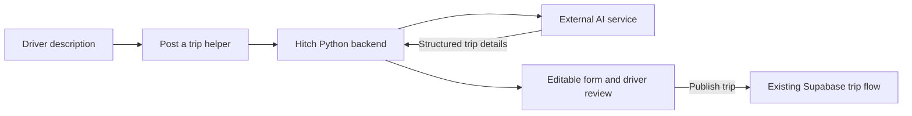

# Sprint 3 AI feature: describe your trip

Status: scoped, not implemented. Based on GitHub main `3fcc4c704eea32495257520ee65e7e62b504b643`, pulled November 15, 2026. Baseline verification passed: 67 JavaScript tests and 3 Python tests.

## What we are building

On **Post a trip**, a signed-in driver describes their trip in plain English and clicks **Fill trip details**. An external AI service extracts the details into the existing form. The driver checks or edits the result, supplies anything missing, and uses the existing **Publish trip** button to save it.

This is one small workflow, not a chatbot. Explore, Profile, the logo, navigation, teammate changes, and existing trip publishing stay as they are.

## Why it fits the assignment

The supplied rubric requires an automation connecting the app to an external service with an AI step, including structured data extraction. This proposal connects the website to an external model API and uses AI to turn a description into structured trip fields. The interpreted result drives the form; a normal trip is saved after the driver reviews it.

That maps to the assignment's wording without adding a separate automation dashboard. A mocked response alone does not count as completion: the deployed website must successfully call the external provider during the demo.

## First version

- One optional, labelled description box and a **Fill trip details** button above the current Post a trip form.
- A small note beside the action explains that the description is sent to the AI provider and that the result needs review.
- One protected backend endpoint, `POST /api/ai/trip-draft`.
- One model request per button press, returning structured JSON rather than generated HTML or executable code.
- Loading, success, missing-information, and error feedback that works with a screen reader.
- The existing form and preview update after successful extraction. Manual entry continues to work if AI is unavailable.
- No new database tables or migrations. No separate agent framework or chat history.

## What AI may fill

| Existing field | Output |
| --- | --- |
| Starting city | `origin_city` |
| Destination | `destination_name` |
| Departure date and time | `departure_date` and `departure_time` |
| Pickup and arrival location | `pickup_location` and `dropoff_location` |
| Available seats | `seats` |
| Price per seat | `price_per_seat` |
| Optional return | `return_requested`, `return_date`, and `return_time` |

All fields can be unknown. Missing or ambiguous values stay empty and are listed for the driver to complete. AI must not invent a meeting point, price, seat count, or precise time. For this version, use explicit calendar dates; vague dates such as "sometime next weekend" are left for the driver to choose. Dates and times are interpreted as Mountain Time, matching the current form.

The model cannot choose a driver, grant verification, set a pickup code, access private car details, or publish a trip. It does not generate map coordinates. Existing address search and map selection remain available.

## Integration details

1. The browser sends the description and the existing Supabase access token to the Python backend. It does not send the whole profile or car information.
2. The backend checks the request origin, body size, signed-in identity, and eligibility before calling AI. The Supabase project URL is configured by the server, never supplied by the caller.
3. A dedicated provider key is held in the server's environment. It never goes in public JavaScript, `supabase-config.json`, a screenshot, or Git history.
4. The backend calls the provider with a fixed extraction instruction and an allowed output schema. The description is untrusted data, not instructions to the application.
5. Server validation checks field types, lengths, date formats, seat bounds, price bounds, and return ordering. Unknown and invalid values are not silently substituted with defaults. API refusal, malformed output, timeout, and quota failures produce a clear error.
6. The frontend applies the result without rebuilding or clearing the whole form. It preserves manually entered values, including car details. The untouched default starting city may be replaced; edited fields are left alone. A response arriving after navigation, logout, a newer request, or manual edits cannot overwrite newer work.
7. If the destination or address changes, the existing picker state and corresponding old pin must be cleared through the picker's normal input behavior. AI text never carries over an unrelated saved pin.
8. The driver reviews the result. The existing validation, destination creation, ownership rules, trip insert, and pickup identification workflow run only on **Publish trip**.

Limit input length, output size, request duration, and per-account request frequency. Disable duplicate generation while a request is pending. Do not log descriptions, tokens, keys, or private car details. Rate limiting on one Render process is adequate for this class demo but is not a durable multi-server quota.

## External service decision

OpenAI Structured Outputs is a suitable default for the extraction response. Model selection and credentials remain to be confirmed; another provider can be used if the team already has access. We have not provisioned an account, accepted a paid plan, made a model call, or deployed this feature.

The only external setup dependency is working API access for the chosen provider and its server-side environment configuration on Render. Add a provider spending limit before the class opens the site. Tests can use a fake provider response, but the final smoke test must use the real API.

Sources: [Structured Outputs](https://developers.openai.com/api/docs/guides/structured-outputs), [API key and production setup](https://developers.openai.com/api/docs/guides/production-best-practices).

## Files to change when building

- `public/index.html`: description UI, generation states, and safe application to the current Post a trip controls.
- `public/hitch.css`: styles scoped to the Post a trip helper; no Explore styling changes.
- `server.py` plus a small `ai_trip_draft.py` helper: protected endpoint, provider call, and validation.
- `.env.example`: names of required AI settings, with no real keys.
- `tests/`: extraction validation, auth failures, provider failures, late responses, preserved manual fields, and the existing publish flow.
- `README.md`: setup instructions, an honest AI workflow description, its data-flow diagram, and a short demo sequence.

## Done means

- The real external API extracts the explicit example below on the live website.
- Empty, unrelated, incomplete, and ambiguous descriptions do not fabricate a valid trip.
- The driver can edit the generated fields and publish successfully through the existing Supabase flow; refreshing shows the saved trip.
- Failed or slow AI requests preserve form values and leave manual posting available.
- Authentication is enforced on the backend. Browser files contain no provider key.
- Mobile and desktop controls fit; labels, keyboard use, and status feedback are checked.
- New tests and existing checks pass; Explore's implementation is unchanged.
- The approved implementation is merged to main, Render serves that release, and a real hosted generation is verified.

## Live demo, about 30 to 45 seconds

Use this description:

> Driving from Provo to Moab on November 20, 2026 at 4 PM. Pick up at Wilkinson Student Center and drop off at Moab Visitor Center. I have 3 seats at $25 per seat. Returning November 22, 2026 at 6 PM.

Click **Fill trip details**, show the actual generated fields, check them, then click **Publish trip**. Show the saved trip. Explain that the external AI extracted the description and the normal app saved the reviewed trip.

For rehearsal, use the isolated test environment. Any classroom trip created on the live app must be clearly identified as a presentation demo. Never substitute a stored example or a regular expression result for a failed AI call while claiming the automation succeeded.

## Build order

1. Confirm the AI provider and configure a dedicated key privately.
2. Build the endpoint and extraction validation, with mocked failure tests.
3. Wire the small form helper into Post a trip, preserving teammate changes.
4. Test a real generation and the complete save/refresh flow locally; check mobile.
5. Update the README, merge, deploy, and verify the same workflow on Render.
